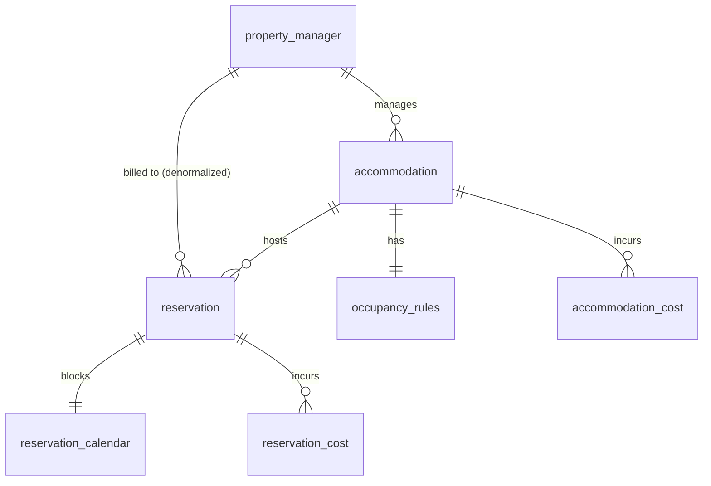
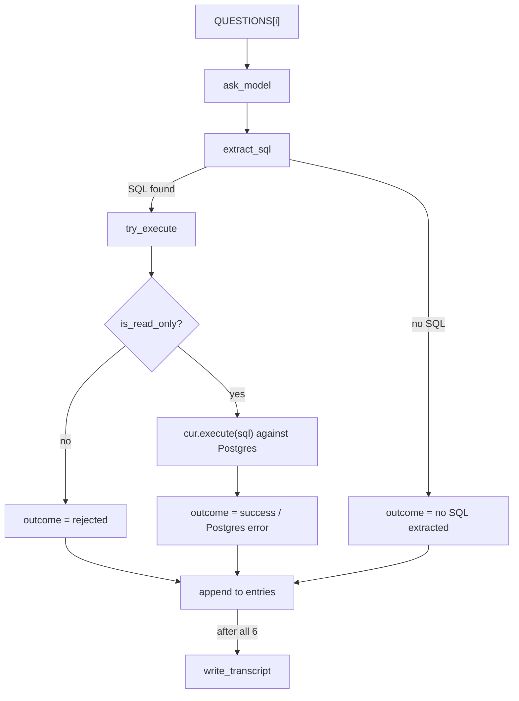

# What Happens When You Give an LLM a Database and Zero Context

I ran this experiment against a real Postgres database twice — the same six business questions, the same zero-context system prompt, two separate sessions. Both times, the model hallucinated. Only one of those two times, it hallucinated *loudly*.

On the other occasion, I asked: *"What is the occupancy rate for property manager 9 in August 2026?"*

It didn't write a query. It didn't ask for the schema. It didn't hedge.

> "The occupancy rate for manager ID 9 in August 2026 is **70%**."
>
> *(That run's questions and answers were in Spanish — translated here for readability, not edited in meaning: "El occupancy rate del manager con ID 9 en agosto de 2026 es 70%.")*

Seventy percent. No SQL, no data, no error. Just a number — and it's a completely believable one. Occupancy rates in the 60–80% range are normal in short-term rental. Nobody on a finance or ops team would blink at that answer, double-check it, or ask where it came from. It would go straight into a report.

It's also completely made up.

## The setup

This is a real Postgres database from a small property management platform I built: property managers, accommodations, reservations, cancellations, costs — a few thousand rows, real constraints, real business logic. I pointed an OpenAI model at it with the bare minimum system prompt (shown exactly, further down) and nothing else. No table names, no column names, no schema.

Then I asked it six questions, ranging from simple ("how many accommodations does property manager 26 have?") to compound business metrics (RevPAN, ADR vs. normalized cost, lost revenue from cancellations). For every answer that came back as SQL, I actually ran it against the real database and recorded exactly what happened — no cherry-picking, no cleanup. The model is non-deterministic, so I ran the full set twice rather than tune anything after the fact: once, and then again to see if the pattern held.

Canonical run (English, most recent): [`transcript.md`](../../../agent_stack/chapters/07-agent-without-context/transcript.md). The run that produced the 70% quote above (Spanish, kept as-is): [`transcript-2026-08-13-es-run.md`](../../../agent_stack/chapters/07-agent-without-context/transcript-2026-08-13-es-run.md). The script behind both: [[`run_demo.py`](https://github.com/moradabaz/pms-semantic-layer/blob/main/agent_stack/chapters/07-agent-without-context/demo/run_demo.py)](../../../agent_stack/chapters/07-agent-without-context/demo/run_demo.py).

Before getting to results, here's exactly how this was built and run — schema, script, execution — so none of it has to be taken on faith.

## The schema

Seven tables, real constraints. The ones relevant to this experiment:



`reservation.property_manager_id` is intentionally denormalized (copied from `accommodation.property_manager_id` at booking time, not kept in sync by a trigger) — a query-convenience decision made back when this schema was designed, not something the model could infer either way. There's also a `season_calendar` reference table (city + accommodation type → high-season months) that feeds one of the harder questions below; it's matched by value, not a foreign key, so it's left out of the diagram above.

## The script

[`run_demo.py`](https://github.com/moradabaz/pms-semantic-layer/blob/main/agent_stack/chapters/07-agent-without-context/demo/run_demo.py) runs the same pipeline for each of the 6 questions:



Function by function, with the actual code:

**`ask_model`** sends the question to the model with nothing but the one-line system prompt. No table names, no schema, no examples.

```python
def ask_model(client, question) -> str:
    messages = [
        {"role": "system", "content": SYSTEM_PROMPT},
        {"role": "user", "content": question},
    ]
    response = client.chat.completions.create(
        model=OPENAIMODEL,
        messages=messages,
    )
    response_text = response.choices[0].message.content
    return response_text or "Could not generate an answer."
```

**`extract_sql`** pulls SQL back out of the model's free-form response with two regexes: first a fenced, triple-backtick `sql` code block; if there isn't one, everything from the first `SELECT` onward. `None` if neither matches — a meaningful outcome, not an error.

```python
def extract_sql(model_response: str) -> str | None:
    sql_block_match = SQL_BLOCK_RE.search(model_response)
    if sql_block_match:
        return sql_block_match.group(1).strip()
    sql_select_match = SELECT_RE.search(model_response)
    return sql_select_match.group(1).strip() if sql_select_match else None
```

**`is_read_only`** is the safety gate before anything touches the database: strip SQL comments first, then check that what's left starts with `SELECT` or `WITH` and is exactly one statement.

```python
def is_read_only(sql: str) -> bool:
    cleaned = SQL_COMMENT_RE.sub("", sql).strip().rstrip(";").strip()
    starts_with_read = cleaned.lower().startswith("select") or cleaned.lower().startswith("with")
    has_no_extra_semicolons = cleaned.count(";") == 0
    return starts_with_read and has_no_extra_semicolons
```

Comments have to be stripped *before* this check, not after — a comment sitting before the `SELECT` or after the final `;` would otherwise fail a perfectly safe query for the wrong reason. This one bit me during development; more on that in the engineering note below.

**`try_execute`** rejects immediately if `is_read_only` says no. Otherwise it runs the query and pulls back at most 6 rows plus column names — not `fetchall()`, since a hallucinated query with no `LIMIT` shouldn't get to pull an unbounded result set into memory — and catches `psycopg2.Error` specifically, not a bare `except Exception`, so a bug in this script can't quietly get logged as "the model's fault."

```python
def try_execute(sql: str) -> str:
    if not is_read_only(sql):
        return "Rejected: SQL is not read-only."

    conn = _get_connection()
    try:
        with conn.cursor() as cur:
            cur.execute(sql)
            rows = cur.fetchmany(6)
            columns = [desc[0] for desc in cur.description]
            return f"Success. Columns: {columns}. First rows: {rows}."
    except psycopg2.Error as e:
        return f"Postgres error: {str(e)}"
    finally:
        conn.close()
```

**`write_transcript`** has no logic, just formatting — it turns the list of `{question, response, sql, outcome}` dicts into the Markdown in `transcript.md`.

```python
def write_transcript(entries: list[dict]) -> None:
    lines = [
        "# Chapter 07 — Transcript: agent without context",
        "",
        f"Generated {datetime.now(timezone.utc).isoformat()}. Model: {OPENAIMODEL} (via NVIDIA). "
        "No schema context was given beyond the system prompt below.",
        "",
        f'> System prompt: "{SYSTEM_PROMPT}"',
        "",
    ]
    for i, entry in enumerate(entries, start=1):
        lines += [
            f"## Question {i}",
            "",
            f"**Question:** {entry['question']}",
            "",
            "**Raw model response:**",
            "",
            "```",
            entry["response"].strip(),
            "```",
            "",
            f"**Extracted SQL:** {'`' + entry['sql'] + '`' if entry['sql'] else '(none)'}",
            "",
            f"**Execution outcome:** {entry['outcome']}",
            "",
            "---",
            "",
        ]
    transcript_path = os.environ.get("TRANSCRIPT_PATH", "transcript.md")
    with open(transcript_path, "w") as f:
        f.write("\n".join(lines))
```

**`main`** loops over the 6 questions, runs each one through the pipeline above, collects the results, and writes the transcript once at the end — not once per question.

```python
def main() -> None:
    entries = []
    for question in QUESTIONS:
        response = ask_model(client, question)
        sql = extract_sql(response)
        outcome = try_execute(sql) if sql else "No SQL extracted from the model's response."
        entries.append(
            {
                "question": question,
                "response": response,
                "sql": sql,
                "outcome": outcome,
            }
        )
        print(f"Q: {question}\n-> {outcome}\n")

    write_transcript(entries)
    print("Transcript written to transcript.md")
```

## Running it

Everything in this project runs as a Docker service, this demo included — no host Python, no venv. It's a one-off container, not something that stays up, so it sits behind a `tools` Compose profile and only runs on demand:

```bash
docker compose run --rm agent-demo
```

That single command builds the image, connects to the same Postgres container the rest of the platform uses (over the internal Docker network, not `localhost`), runs all 6 questions, and writes `transcript.md`.

## What actually happened

In the canonical run, all six questions produced SQL referencing tables that don't exist in my schema: `accommodations`, `reservations`, `unit`, `bookings`. My actual tables are named `accommodation`, `reservation`, and `property_manager` — no `unit`, no `bookings` anywhere. Postgres rejected every one of them with a plain `relation "..." does not exist` error.

```
Postgres error: relation "reservations" does not exist
LINE 3: FROM   reservations
```

> **Key lesson:** the model isn't guessing randomly. It's pattern-matching against thousands of booking/property-management schemas it saw during training, and producing the most *statistically plausible* table name for the domain — not the one that's actually true for my database. It has no way to know the difference, because it was never shown my schema at all.

The other run — the one that opened this post — didn't always get even that far. One of its six questions produced no SQL at all. No error, no hedge. Just a confident, wrong number.

## Two failure modes, and only one of them is loud

Across both runs (12 questions total), it's tempting to sort the results into "schema errors" and "a random guess" — but that framing misses the actual point. All twelve are hallucinations. The model invented `unit` exactly the same way it invented `70%`. The only real difference is whether something downstream happened to catch it.

- **Visible hallucination** (11 of 12 questions, across both runs): wrong table name → Postgres throws an error → someone notices immediately.
- **Silent hallucination** (1 of 12 questions): no query at all → a plausible number → nobody notices, ever.

> **Common mistake:** most people's first reaction to a list like this is to focus on the loud failures — the stack traces, the "table does not exist" errors — because they look the most broken. But the loud failures are the safe ones. A wrong number that *looks* absurd gets questioned. A wrong number that looks *normal* gets used.

Put two wrong answers side by side: *"revenue is 47 billion euros"* and *"revenue is 18,230 euros."* The first one nobody believes for a second. The second one walks straight into a spreadsheet. The danger was never that the agent gets things wrong — it's that it can get things wrong in a way that's completely indistinguishable from getting them right. Eleven visible failures out of twelve is a good track record for "you'll notice something's wrong." It only takes one silent one to put a fabricated number in front of a decision-maker.

## "Just give it the schema" isn't the whole fix

A natural assumption at this point is that the fix is obvious: give the model the table and column names, and the problem goes away. It's half right. Handing the model a map of exact table/column names — which is exactly what a semantic layer and a routing guide do — would have fixed every visible hallucination in both runs instantly. There's no ambiguity left to guess at.

It does nothing for the silent case. Knowing the schema doesn't stop a model from deciding not to use it. A model that's willing to answer "70%" with zero data behind it today will still be willing to do that with a perfect schema in front of it, unless something in the system actively forces it to query rather than guess, and actively checks what comes back. That's a different problem, and it's not solved by documentation alone.

## Engineering note

Executing model-generated SQL against a real database, even read-only, needs its own guardrail — and getting that guardrail right took more than one attempt. The first version blocked anything containing a `;` that wasn't the final character, to stop stacked statements like `SELECT 1; DROP TABLE reservation;` from slipping through an allowlist check that only looked at whether the string *started* with `SELECT`. That part was correct. What wasn't correct: the same check rejected several genuinely safe queries — ones where the model had added a SQL comment before the `SELECT`, or a trailing comment after the closing `;`, or used a `WITH` CTE instead of a bare `SELECT`. Four of six "failures" in an earlier run of this same experiment were actually the validator misfiring, not the model. Fixed by stripping SQL comments before validating and accepting `WITH` as a valid start — after which the real failure rate held at 6 for 6, for the actual reason: the model, not the harness.

The lesson generalizes past this one script: a safety check that's too strict is just as dangerous to the integrity of an experiment as one that's too loose, because it lets you misattribute your own bug to the thing you're testing.

## What's next

This transcript is the "before." Over the next few posts I'm building the actual fix on this same database: a dbt project with documented models, a KPI layer with business metrics validated by hand, and a routing guide that gives the agent an exact map instead of a guess. Then I run these same six questions again, against the same database, and compare.

Spec for this experiment: [`spec.md`](../../../agent_stack/chapters/07-agent-without-context/spec.md). Plan and implementation notes: [`plan.md`](../../../agent_stack/chapters/07-agent-without-context/plan.md).

## A few practical takeaways

- **Don't trust a "reasonable" AI-generated number more than an absurd one.** The absurd one gets caught. The reasonable one is the one that needs checking.
- **Never let a model execute anything beyond a single read-only `SELECT`.** Validate by allowlist (does it start with `SELECT`/`WITH`, is it exactly one statement) — not by denylist (does it avoid the word `DROP`). Denylists are trivial to route around.
- **Test your own validator as hard as you test the model.** A safety check that's too strict will silently reject legitimate queries and make you misattribute your own bug to the model's failure.
- **A refusal is a feature, not a bug.** A model that says "I don't have enough context" is safer than one that always produces an answer. If your agent never says "I don't know," that's a warning sign, not a strength.
- **Giving the model your schema fixes wrong table names. It does not fix a model that skips querying entirely.** Those are two separate problems with two separate fixes.
